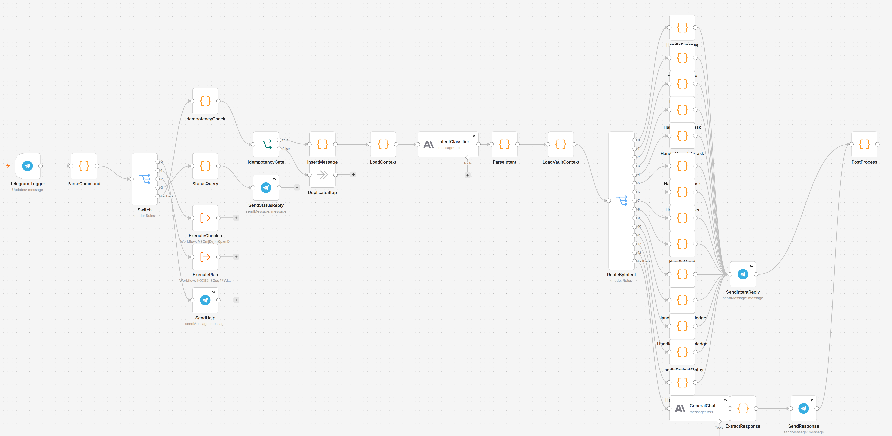
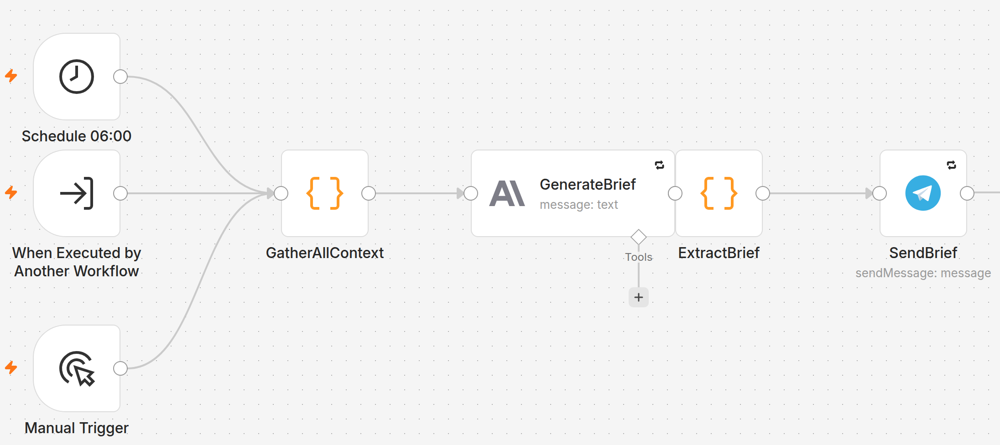
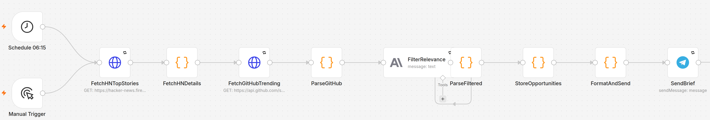
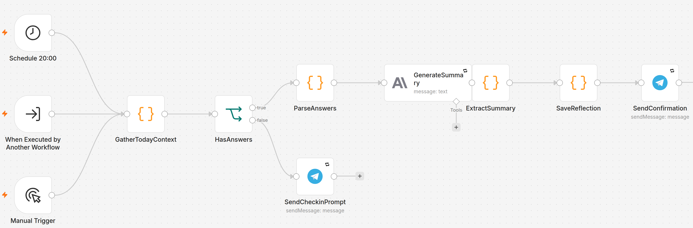
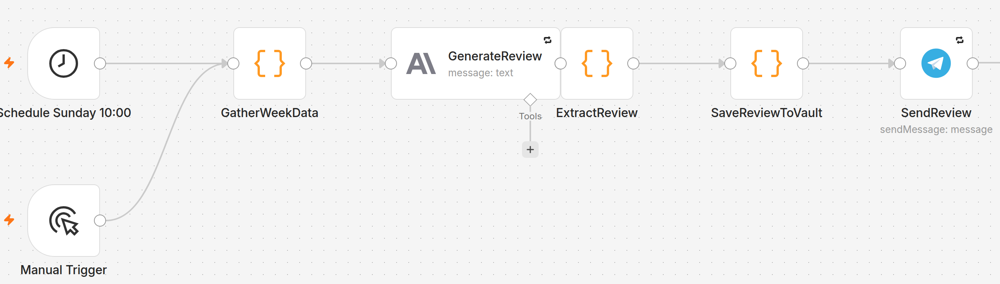
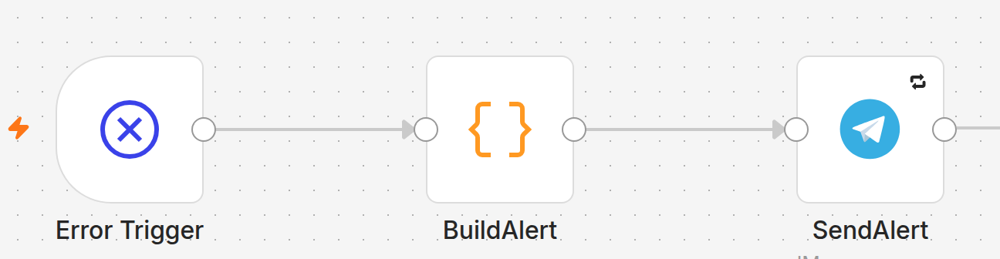

# Personal AI Assistant: Telegram, n8n and Claude

A self-hosted assistant I message on Telegram. It sorts each message into one of 15 intents,
records it in a SQLite database (expenses, tasks, habits, mood, ideas, notes), and sends me a
morning brief, an evening check-in, a weekly review and a daily digest of what is worth reading.
Claude Haiku 4.5 does the language work. n8n runs the workflows. My own notes give it context.

It has been running since June 2026, was rebuilt in August, and was audited and repaired in
October after a review found two of its five workflows had never succeeded on a schedule. This
repository is the working system, the audit, and the tests, not a demo.

## What is in it

| Workflow | Runs | Does |
|----------|------|------|
| Personal Assistant v2 | on each Telegram message | allow-list, duplicate check, intent classifier, 15 handlers |
| Morning Brief v2 | 06:00 daily, or `/plan` | a short brief from tasks, projects, habits, spending |
| Intel Brief Scanner | 06:15 daily | Hacker News and GitHub, filtered by Claude for relevance to the owner |
| Evening Reflection v2 | 20:00 daily, or `/checkin` | summarises the day, saves a reflection |
| Weekly Review | Sunday 10:00 | weekly summary, saved as a note and sent |
| Error Alert | when any of the above fails | tells the owner which workflow and node broke |

The main router, exported from the live instance (36 nodes: allow-list, duplicate check, intent
classifier, 15 handlers):



<details>
<summary>The other five workflows</summary>

**Morning Brief**


**Intel Brief Scanner**


**Evening Reflection**


**Weekly Review**


**Error Alert**


</details>

How a message travels, and the trust boundaries: [docs/architecture.md](docs/architecture.md).

## How it grew

| When | Stage |
|------|-------|
| June 2026 | **Capture.** Telegram message in, note out, one workflow |
| August 2026 | **Life tracker.** A written plan (19 features, 5 phases) became a classifier plus 15 handlers over a 31-table database, with scheduled briefs generated from it |
| October 2026 | **Reliable.** A review of the live instance found failures nobody had seen. Fixes, alerts and tests |

Dated timeline with the evidence for each step: [docs/history.md](docs/history.md).

## The October audit, in short

Reading the execution history showed **Morning Brief had failed on all 11 retained scheduled
runs and Intel Brief on all 11**, one on a call to a method that does not exist, the other on
returning an array where n8n needs an object. The bot also answered anyone who found it, a
reminder feature replied "Reminder set" and stored nothing, and "delete task" could remove many
tasks at once. All of it is fixed in the live instance, and the two failing workflows were run
once afterwards: both delivered, and Intel Brief stored 8 rows in a table that had been empty.

Full table of findings, fixes and evidence: [docs/audit-2026-10-25.md](docs/audit-2026-10-25.md).

## Status, honestly

- **Verified:** the Code-node logic (14 tests, no n8n needed); a real run of Morning Brief and
  Intel Brief on the live instance; the install scripts on a clean n8n (start, database,
  import, linking credentials to all 17 nodes that need them).
- **Not yet verified:** the sender allow-list, reminders and delete with a real Telegram
  message; the error alert firing; switching the workflows on against a real Telegram bot,
  which needs a public address and a bot token.
- **Known gaps:** two overlapping runs can overwrite each other's database change; backups are
  manual; some n8n settings are looser than they should be. See [docs/hardening.md](docs/hardening.md).
- **Not built:** timed push reminders, calendar, email and contact follow-ups. They are in the
  plan, and some tables exist, but no workflow uses them yet.

## Repository map

```
workflows/     the six workflows exported from the live instance (credentials removed)
scripts/       install.sh and link-credentials.sh: the two commands that set it up
sql/           schema of the assistant database, no data
vault-sample/  fictional notes in the structure the router reads
tests/         code_nodes.test.js (workflow logic) and tests of the publishing tools
tools/         scan.py (secret and personal-data scan), sanitize_n8n.py (clean an n8n export)
docs/          architecture, history, the October audit, hardening status; images/ = canvas screenshots
```

## Get it for yourself

**You need:** Docker, a Telegram bot token (message [@BotFather](https://t.me/BotFather)), your
own Telegram chat id (message [@userinfobot](https://t.me/userinfobot)), an
[Anthropic API key](https://console.anthropic.com), and a public https address that reaches your
machine, such as a Cloudflare Tunnel or ngrok, so Telegram can deliver messages to the bot.

**1. Download and configure**

```bash
git clone https://github.com/Yusufabasi/personal-assistant-case-study.git
cd personal-assistant-case-study
cp .env.example .env        # set TELEGRAM_CHAT_ID (yours) and WEBHOOK_URL (your https address)
```

**2. Install** (starts n8n, installs the SQLite library, creates the database, imports the workflows)

```bash
./scripts/install.sh
```

**3. Finish in the n8n editor** at <http://localhost:5678>

1. Create the owner account.
2. Add two credentials: **Telegram API** (your bot token) and **Anthropic API** (your key).
3. Back in the terminal, run `./scripts/link-credentials.sh`. It connects your two credentials to
   all 17 nodes that need them.
4. Open each of the six workflows and switch it on. Switch on **Error Alert** last.

**4. Make it yours**

- Fill in the `[YOUR ...]` placeholders in two nodes: `IntentClassifier` in *Personal Assistant
  v2* and `FilterRelevance` in *Intel Brief Scanner*.
- Replace the fictional notes in `vault-sample/AI Memory/` with your own, or point the `/vault`
  mount in `docker-compose.yml` at your notes folder. The assistant reads four of them for context.

Then message your bot. Try `/help`, `/plan`, `/checkin`, or just talk: *"spent 500 on lunch"*,
*"add task: finish the report"*, *"I slept 6 hours"*.

Only the chat id in `.env` can use the bot. Everyone else is ignored. If something fails,
**Error Alert** messages you which workflow and node broke. To update later, `git pull` and
re-run `./scripts/install.sh`; it never overwrites your database.

## Tests and checks

```bash
npm install && npm test                 # 14 checks on the Code-node logic
pip install pytest && pytest            # the publishing tools
python tools/scan.py .                  # must print 0 finding(s)
```

CI runs all three on every push.

## Credits

The assistant is the owner's own project: the idea, the build plan, the n8n workflows and the
instance they run on.

The October 2026 audit and repair were done together with **Claude** (Anthropic, through Claude
Code), working at the owner's direction. Claude read the live instance's execution history,
found the causes of the failures, wrote and applied the fixes, wrote the tests and install
scripts, and drafted these docs from the evidence. The owner reviewed and approved each change
to the live instance and decided what to publish. Commits made with Claude's help carry a
`Co-Authored-By: Claude` line.

## Before publishing anything from your own instance

Run exports through `tools/sanitize_n8n.py`, then `tools/scan.py` on the folder. If a real key
was ever committed, rotate it: deleting the commit is not enough.
