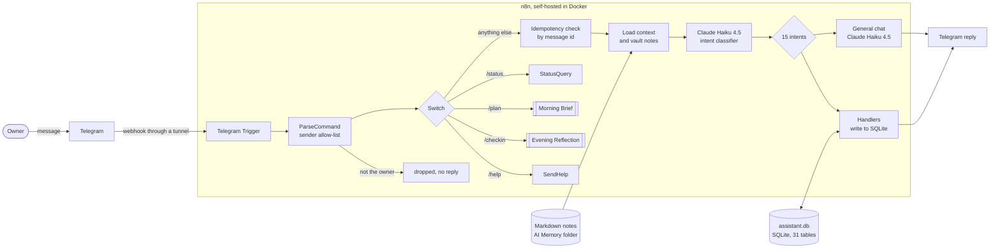

# Architecture

A self-hosted assistant: Telegram is the interface, n8n is the orchestrator, Claude Haiku 4.5
does the language work, SQLite holds structured data, and a folder of Markdown notes gives the
model long-term context about its owner.

## The workflows

| Workflow | Trigger | What it does |
|----------|---------|--------------|
| **Personal Assistant v2** (36 nodes) | Telegram message | Allow-list, duplicate check, intent classification, then one of 15 handlers: expenses, income, events, tasks (create, complete, delete, list), habits, mood, ideas, saving and querying knowledge, project status, reminders, or general chat |
| **Evening Reflection v2** | 20:00 daily, or `/checkin` | Summarises the day's tasks, spending and habits; with answers, saves a reflection and a Claude summary |
| **Morning Brief v2** | 06:00 daily, or `/plan` | Gathers tasks, projects, habits, spending and contacts, and has Claude write a short brief |
| **Intel Brief Scanner** | 06:15 daily | Fetches Hacker News and GitHub, has Claude score each item against the owner's profile, stores the relevant ones and sends a digest |
| **Weekly Review** | Sunday 10:00 | Summarises the week, saves it as a Markdown note and sends it |
| **Error Alert** | Any other workflow failing | Sends the failing workflow, node and message to Telegram |

Times are in `Africa/Nairobi`.

## Data

`sql/schema.sql` defines 31 tables (tasks, expenses, habits, mood, ideas, knowledge, contacts,
opportunities, reflections and others). Code nodes read the whole SQLite file with `sql.js`,
change it in memory and write it back through a temporary file and a rename, so a crash cannot
leave a half-written database. See [hardening](hardening.md) for what that design does not protect
against.

## Trust boundaries

1. **Telegram to n8n.** Anyone can message a public bot. `ParseCommand` compares the sender's
   chat id with `TELEGRAM_CHAT_ID` and drops everything else. If the variable is empty, everyone
   is dropped.
2. **The server.** n8n, the database, the notes and the credentials live here. The reference
   `docker-compose.yml` binds the editor to localhost; Telegram reaches only the webhook,
   through a tunnel.
3. **The model API.** Whatever goes into a prompt leaves the server. The classifier receives the
   message and recent memory; the general-chat step also receives four notes (profile, goals,
   projects, current context). The model has no tools: it returns text, and the workflow decides
   what to do with it. A model answer that is not valid JSON falls back to a plain capture.
